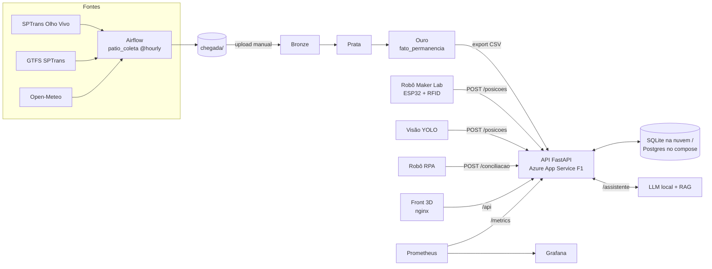

# Pátio Monitor

**Visão única do pátio para terminais e garagens de ônibus.**
FIAP · Engenharia de Software · 4º ano · Global Solution 2026.2 · Desafio CitizenTech

## Integrantes

| Nome completo | RM | Disciplinas |
|---|---|---|
| Felipe Bressane | RM 97688 | Big Data, DevOps & Cloud |
| Gabriel Teixeira | RM 551570 | Generative AI, Computer Vision, front do MVP |
| Camila do Prado | RM 98316 | RPA, Maker Lab |

**MVP:** [URL pública] · **Pitch:** [link do vídeo]

## Ficha Técnica do MVP

| Campo | Pátio Monitor |
|---|---|
| Cidadão e território | O passageiro que espera na plataforma e o controlador de terminais e garagens de ônibus em São Paulo. O Terminal Pirituba é o cenário de referência. |
| Problema | Escala, portaria e rastreamento não concordam sobre onde está cada ônibus, e o controlador decide sem saber se o veículo está fora, manobrando ou foi trocado. |
| Proposta de valor | Uma visão única do pátio que cruza o previsto com o registrado e aponta pendências enquanto ainda dá tempo de agir. |
| Arquitetura | Front web com pátio 3D, API do produto, pipeline de dados (Airflow → Databricks), assistente de IA local com RAG, detector de visão, robô de conciliação (RPA) e robô físico na maquete, publicados por CI/CD em nuvem. |
| Fontes de dados | SPTrans Olho Vivo (posições reais), GTFS da SPTrans (viagens previstas), Open-Meteo (clima) e portaria simulada em CSV, com a regra de geração documentada. |
| Modelos de IA | LLM local com RAG, YOLO treinado para veículos no pátio e o modelo embarcado no robô. |
| Indicadores de impacto | Porcentagem de partidas no horário, tempo para localizar um veículo, saídas sem confirmação por dia e tempo médio de permanência. |
| ODS | ODS 11 (meta 11.2) e ODS 9. |
| IA responsável | O assistente e a visão apenas sugerem. A decisão é sempre do controlador. |

## Arquitetura



## Estrutura do repositório

| Pasta | Conteúdo | Disciplina |
|---|---|---|
| `api/` | API FastAPI, Dockerfile multi-stage e testes | DevOps / todas |
| `front/` | Front de demonstração servido por nginx (o front definitivo com o pátio 3D é do Gabriel) | todas |
| `docs/contrato-api.md` | Contrato JSON de `/posicoes`, `/conciliacao` e `/assistente` | todas |
| `bigdata/dags/` | DAG `patio_coleta` do Airflow | Big Data |
| `bigdata/databricks/` | Notebooks Bronze, Prata, Ouro e as 5 consultas | Big Data |
| `bigdata/scripts/gerar_portaria.py` | Geração documentada da portaria e da escala simuladas | Big Data |
| `infra/terraform/` | Azure App Service F1 (custo zero) | DevOps |
| `.github/workflows/ci-cd.yml` | Testes, Gitleaks, Semgrep, Trivy e deploy | DevOps |
| `monitoramento/` | Prometheus, alertas e painel Grafana dos 4 sinais de ouro | DevOps |

## Como rodar localmente

**Com Docker (sistema completo):**

```bash
cp .env.example .env      # preencha as senhas
docker compose up -d --build
# MVP em http://localhost  ·  API em http://localhost:8000/docs
docker compose --profile monitoramento up -d   # Grafana em http://localhost:3000
```

**Só a API, sem Docker:**

```bash
cd api
python -m venv .venv && .venv/Scripts/activate   # Linux/macOS: source .venv/bin/activate
pip install -r requirements.txt pytest
pytest -q tests
uvicorn app.main:app --reload
```

Para abrir o front sem Docker, sirva a pasta `front/` (por exemplo, `python -m http.server 5500`) e acesse `http://localhost:5500/?api=http://localhost:8000`.

Com `DEMO=true`, a API cria 10 ônibus fictícios e alguns alertas, e move esses ônibus sozinha. O selo "DEMO · dados simulados" aparece na tela. Assim que o robô, a câmera ou o GPS mandam um evento de um veículo, a simulação deixa de mexer nele.

## Pipeline de dados (Big Data)

1. No Airflow, crie as Variables `sptrans_token`, `gtfs_zip_url` e `patio_chegada_dir`, e coloque `bigdata/dags/patio_coleta.py` na pasta de DAGs.
2. Depois de ter lotes de pelo menos 2 dias, gere a portaria e a escala simuladas:
   `python bigdata/scripts/gerar_portaria.py <pasta chegada> <pasta chegada>`
3. Suba os arquivos de `chegada/` para o Volume `/Volumes/workspace/patio/chegada` e rode os notebooks `01` → `02` → `03` → `04`.
4. Exporte o resultado final do `03_ouro` como `data/ouro/fato_permanencia.csv`. A API serve esse arquivo em `GET /permanencia`.

Nenhum token ou dado pessoal real vai para o repositório. A pasta `bigdata/amostras/` recebe só um pouco de cada fonte, sem token.

## Deploy (DevOps) · custo zero

Mesmo caminho da GS Cloud do AgroSatélite (semestre passado): **Azure App Service no plano F1 (Free)**, agora criado por Terraform e publicado por um pipeline DevSecOps.

| Recurso | Custo |
|---|---|
| App Service Plan F1 + Linux Web App (Python 3.12) | US$ 0 (plano gratuito) |
| SQLite em `/home/data` do App Service | US$ 0 (incluso no plano) |
| State do Terraform local (fora do Git) | US$ 0 |
| GitHub Actions em repositório público | US$ 0 |
| Prometheus + Grafana local apontando para a URL publicada | US$ 0 |
| **Total** | **US$ 0/mês**, sem gastar o crédito do Azure for Students |

Limites do F1, que entram no PDF: 60 min de CPU por dia, 1 GB de RAM e sem Always On. Depois de cerca de 20 min sem acesso o app dorme, e a primeira requisição demora alguns segundos.

1. `az login` e `cd infra/terraform`. Copie `terraform.tfvars.example` → `terraform.tfvars` (fica fora do Git) e coloque o `subscription_id`.
2. `terraform init && terraform apply`. A saída `url_mvp` é a URL pública.
3. Crie o service principal do deploy com acesso só ao resource group, igual ao `GUIA_AZURE` da GS Cloud:
   `az ad sp create-for-rbac --name sp-patio-monitor --role contributor --scopes /subscriptions/<id>/resourceGroups/rg-patio-monitor --sdk-auth`
4. Em GitHub Secrets, cadastre `AZURE_CREDENTIALS` (o JSON do passo 3), `AZURE_WEBAPP_NAME`, `AZURE_RESOURCE_GROUP`, `INGEST_API_KEY`, `METRICS_TOKEN` e `ASSISTENTE_URL`. Crie também o environment `producao`.
5. Todo push na `main` passa por testes, Gitleaks, Semgrep, Trivy (código, IaC e imagens) e só depois faz o deploy automático.

**Porta de administração:** o App Service não tem SSH aberto. O painel Kudu/SCM e o FTP ficam sem login por senha (FTP desligado), então só entra quem tem acesso Entra ID com RBAC.

**Observabilidade:** coloque o mesmo valor do secret `METRICS_TOKEN` no arquivo `monitoramento/metrics_token` (fora do Git) e rode `docker compose --profile monitoramento up -d`. O Prometheus lê o `/metrics` do MVP publicado (job `patio-azure`), e o Grafana mostra os 4 sinais de ouro.

O `docker compose` (front nginx + API + Postgres) é a stack completa para rodar e demonstrar localmente. Na nuvem, o mesmo código roda no App Service com SQLite, para não ter custo.

## LGPD e segurança

- A matrícula e o nome do motorista existem só na portaria simulada (são fictícios) e chegam à Ouro como SHA-256. A API não expõe essas colunas.
- Os logs da API e do assistente não guardam nome de motorista.
- Os segredos ficam em `.env` local, em GitHub Secrets ou nas App Settings do App Service (gravadas pelo pipeline). O `.gitignore` bloqueia `.env`, `*.tfvars`, `*.tfstate` e `monitoramento/metrics_token`.
- Os containers rodam com usuário não root. Na nuvem, o `/metrics` exige token.
