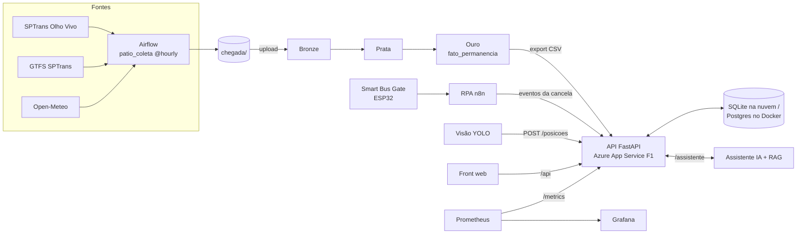

# 🚌 Pátio Monitor | Plataforma, Dados e DevOps

### Global Solution 2026.2 — FIAP
**Tema: CitizenTech | Engenharia de Software · 4º ano**

## 👥 Integrantes

| Nome | RM |
|---|---|
| Camila do Prado Padalino | 98316 |
| Felipe Cavalcante Bressane | 97688 |
| Gabriel Teixeira Machado | 551570 |

🌐 **MVP no ar:** https://patio-monitor-gs-97688.azurewebsites.net · 📘 **API (Swagger):** [/docs](https://patio-monitor-gs-97688.azurewebsites.net/docs) · 🎥 **Pitch:** [Adicionar link do vídeo]

---

## 📌 Sobre o projeto

Num terminal de ônibus, a **escala**, a **portaria** e o **rastreamento** raramente concordam sobre onde está cada veículo. O controlador decide sem saber se o ônibus está fora, manobrando ou foi trocado, e o passageiro na plataforma espera um ônibus que "sumiu".

O **Pátio Monitor** é uma **visão única do pátio** que cruza o que estava previsto com o que aconteceu de fato e aponta as pendências enquanto ainda dá tempo de agir.

Este repositório é o **núcleo do produto**: a API que recebe e serve os dados do pátio, o front de demonstração, o pipeline de dados (Airflow → Databricks) e toda a esteira de DevOps que publica o MVP na nuvem. As outras peças (Smart Bus Gate, automação RPA, IA) ficam em repositórios próprios e se conectam a este pela API.

> 💡 **Nossa missão:** dar ao controlador, em uma tela, a resposta para "onde está o ônibus e o que eu faço agora?".

## 🧾 Ficha Técnica do MVP

| Campo | Pátio Monitor |
|---|---|
| Cidadão e território | O passageiro que espera na plataforma e o controlador de terminais e garagens de ônibus em São Paulo. O Terminal Pirituba é o cenário de referência. |
| Problema | Escala, portaria e rastreamento não concordam sobre onde está cada ônibus, e o controlador decide sem saber se o veículo está fora, manobrando ou foi trocado. |
| Proposta de valor | Uma visão única do pátio que cruza o previsto com o registrado e aponta pendências enquanto ainda dá tempo de agir. |
| Arquitetura | Front web, API do produto, pipeline de dados (Airflow → Databricks), Smart Bus Gate (ESP32), automação RPA no n8n, assistente de IA e detector de visão, publicados por CI/CD em nuvem. |
| Fontes de dados | SPTrans Olho Vivo (posições reais), GTFS da SPTrans (viagens previstas), Open-Meteo (clima) e portaria simulada em CSV, com a regra de geração documentada. |
| Modelos de IA | Assistente do controlador com LLM e RAG, YOLO para veículos no pátio e o modelo de Machine Learning do Smart Bus Gate. |
| Indicadores de impacto | Porcentagem de partidas no horário, tempo para localizar um veículo, saídas sem confirmação por dia e tempo médio de permanência. |
| ODS | ODS 11 (meta 11.2, transporte público acessível e eficiente) e ODS 9 (infraestrutura e inovação). |
| IA responsável | O assistente e a visão apenas sugerem. A decisão é sempre do controlador. |

## 🎯 Objetivos

- 📍 Mostrar em tempo real quais ônibus estão no pátio, onde e há quanto tempo.
- ⚠️ Apontar viagens previstas sem saída confirmada, veículos trocados e vagas erradas.
- 📊 Transformar posições reais da SPTrans em uma tabela de permanência (camada Ouro).
- 🔌 Oferecer uma API única para sensores, câmera, RPA e IA gravarem e lerem eventos.
- 🚀 Publicar o MVP numa URL pública com pipeline DevSecOps e **custo zero**.
- 📈 Medir de verdade a latência e os erros do produto, em vez de só prometer.

## 🛠️ Tecnologias utilizadas

| Tecnologia | Aplicação |
|---|---|
| 🐍 Python + FastAPI | API do produto (`/posicoes`, `/conciliacao`, `/alertas`, `/assistente`, `/permanencia`) |
| 🗄️ SQLite / PostgreSQL | Banco da API (SQLite na nuvem, Postgres no Docker local) |
| 🌐 HTML, CSS e JavaScript | Front de demonstração |
| 🌬️ Apache Airflow | Coleta horária da SPTrans Olho Vivo, GTFS e Open-Meteo |
| 🧱 Databricks + Delta Lake | Medalhão Bronze → Prata → Ouro e consultas SQL |
| 🐳 Docker e Docker Compose | Containers multi-stage sem root (API e front nginx) |
| ☁️ Azure App Service (F1) | Hospedagem do MVP, sem custo |
| 🏗️ Terraform | Infraestrutura como código |
| ⚙️ GitHub Actions | CI/CD com testes, Gitleaks, Semgrep e Trivy |
| 📈 Prometheus + Grafana | Observabilidade: os 4 sinais de ouro e alertas |

## 🔄 Arquitetura da solução



## 🧩 Componentes do projeto

| Componente | Disciplina | Onde está |
|---|---|---|
| 🔌 API, front de demonstração e contrato JSON | Núcleo do produto | [`api/`](api/), [`front/`](front/), [`docs/contrato-api.md`](docs/contrato-api.md) |
| 📊 Pipeline de dados (Airflow + Databricks) | Big Data Architecture & Data Integration | [`bigdata/`](bigdata/) |
| 🚀 Containers, Terraform, CI/CD e observabilidade | Secure DevOps Tools & Cloud Computing | [`devops-cloud/`](devops-cloud/) |
| 🤖 Automação de eventos no n8n | Robotic Process Automation | [RPABusGate_PatioMonitorGS2026](https://github.com/camilapadalino/RPABusGate_PatioMonitorGS2026) |
| 🚦 Smart Bus Gate (ESP32, sensores e IA) | Project-Based Maker Lab | [SmartBusGate_PatioMonitorGS26](https://github.com/camilapadalino/SmartBusGate_PatioMonitorGS26) |
| 💬 Assistente do controlador (LLM + RAG) | Generative AI for Engineering | [`genai/`](genai/) |
| 📷 Detector de veículos e vagas (YOLO) | Applied Computer Vision | [`computer-vision/`](computer-vision/) |

`docker-compose.yml` e `.github/workflows/` ficam na raiz por exigência do Docker Compose e do GitHub Actions.

## 🔌 Integração (API do MVP)

**Base:** `https://patio-monitor-gs-97688.azurewebsites.net/api`

| Método | Endpoint | Para quê | Autenticação |
|---|---|---|---|
| GET | `/health` | Saúde do serviço | — |
| GET | `/layout` | Portão, vagas e plataformas do pátio | — |
| GET | `/posicoes` | Onde está cada ônibus agora e há quanto tempo | — |
| POST | `/posicoes` | Sensor, câmera ou robô informa uma posição | Header `X-API-Key` |
| GET | `/conciliacao` · `/alertas` | Resultado da conciliação e pendências | — |
| POST | `/conciliacao` | Automação grava a conciliação em lote | Header `X-API-Key` |
| POST | `/assistente` | Pergunta ao assistente ("por que este alerta?") | — |
| GET | `/permanencia` | Tabela Ouro de permanência (sem dados de motorista) | — |

Exemplo de evento enviado por um sensor:

```json
{
  "prefixo": "11201",
  "local": "V3",
  "estado": "parado",
  "fonte": "robo",
  "registrado_em": "2026-11-13T14:02:00-03:00"
}
```

O contrato completo, com os códigos de local (`PORTAO`, `V1`–`V12`, `P1`–`P4`, `CIRCULACAO`, `FORA`), está em [`docs/contrato-api.md`](docs/contrato-api.md). A chave `X-API-Key` é passada à equipe por canal privado e nunca vai para o Git.

Com `DEMO=true`, a API cria 10 ônibus fictícios e alguns alertas, e move esses ônibus sozinha. O selo "DEMO · dados simulados" aparece na tela. Assim que um sensor, a câmera ou o GPS mandam um evento de um veículo, a simulação deixa de mexer nele.

## 📊 Pipeline de dados (Big Data)

| Fonte | Origem | Formato | Coleta |
|---|---|---|---|
| Posições dos veículos | SPTrans Olho Vivo, filtrada por raio em volta do Terminal Pirituba | JSON | De hora em hora |
| Viagens previstas (escala) | GTFS da SPTrans (`trips`, `stop_times`, `routes`) | CSV | Diária |
| Clima | Open-Meteo (fonte complementar: chuva × atraso) | JSON | Diária |
| Portaria | CSV simulado a partir das posições reais, com regra documentada | CSV | Diária |

1. **Coleta:** o DAG [`patio_coleta`](bigdata/dags/patio_coleta.py) roda `@hourly` com `catchup=False`, porque a Olho Vivo só devolve a posição atual. Para subir o Airflow local:
   ```bash
   cd bigdata/airflow
   cp .env.example .env          # coloque o SPTRANS_TOKEN (o .env fica fora do Git)
   docker compose up -d          # interface em http://localhost:8081
   ```
2. **Portaria e escala simuladas** (depois de ter lotes de pelo menos 2 dias):
   `python bigdata/scripts/gerar_portaria.py bigdata/chegada bigdata/chegada`
3. **Databricks:** suba os arquivos de `chegada/` para o Volume `/Volumes/workspace/patio/chegada` e rode os notebooks `01_bronze` → `02_prata` → `03_ouro` → `04_consultas`.
4. **MVP:** exporte o resultado do `03_ouro` como `data/ouro/fato_permanencia.csv` e faça commit. O export não tem nenhuma coluna de motorista, e o deploy leva o arquivo ao App Service, que o serve em `GET /permanencia`.

Nenhum token ou dado pessoal real vai para o repositório.

## 🚀 Deploy e DevOps (custo zero)

O MVP roda no **Azure App Service, plano F1 (gratuito)**, em Brazil South, e só chega à nuvem pelo pipeline.

| Etapa do pipeline | O que faz |
|---|---|
| 🧪 Testes | `pytest` da API |
| 🔑 Gitleaks | Procura segredos em todo o histórico do Git |
| 🔍 Semgrep | Análise estática (Python, Dockerfile, Terraform) |
| 🛡️ Trivy | Vulnerabilidades em dependências, IaC e nas imagens Docker |
| ☁️ Deploy | Login com service principal (escopo só no resource group), deploy e health check |

| Recurso | Custo |
|---|---|
| App Service Plan F1 + Linux Web App (Python 3.12) | US$ 0 |
| SQLite em `/home/data` do App Service | US$ 0 (incluso no plano) |
| GitHub Actions (repositório público) | US$ 0 |
| Prometheus + Grafana locais | US$ 0 |
| **Total** | **US$ 0/mês** |

Limites do F1: 60 min de CPU por dia, 1 GB de RAM e sem Always On. Depois de cerca de 20 min sem acesso o app dorme, e a primeira requisição demora alguns segundos.

<details>
<summary><b>Como reproduzir o deploy</b></summary>

1. `az login` e `cd devops-cloud/terraform`. Copie `terraform.tfvars.example` → `terraform.tfvars` (fica fora do Git) e coloque o `subscription_id`.
2. `terraform init && terraform apply`. A saída `url_mvp` é a URL pública.
3. Crie o service principal do deploy com acesso só ao resource group:
   `az ad sp create-for-rbac --name sp-patio-monitor --role contributor --scopes /subscriptions/<id>/resourceGroups/rg-patio-monitor --sdk-auth`
4. Em GitHub Secrets, cadastre `AZURE_CREDENTIALS` (o JSON do passo 3), `AZURE_WEBAPP_NAME`, `AZURE_RESOURCE_GROUP`, `INGEST_API_KEY`, `METRICS_TOKEN` e `ASSISTENTE_URL`, e crie o environment `producao`.
5. Crie a variável de repositório `DEPLOY_HABILITADO=true`.
6. Todo push na `main` passa pelo pipeline e, se tudo passar, publica automaticamente.

**Região:** `brazilsouth`. A Azure permite só um plano F1 Linux por região e por assinatura, e a política do Azure for Students só libera brazilsouth, chilecentral, canadacentral, eastus2 e centralus.

**Certificado (x509 / `CERTIFICATE_VERIFY_FAILED`):** antivírus com inspeção HTTPS (no nosso caso, o "Web/Mail Shield" do Norton) quebra o Azure CLI e o Terraform. A solução foi juntar a raiz do antivírus ao `cacert.pem` do Azure CLI e apontar `REQUESTS_CA_BUNDLE` para esse arquivo. No Git Bash, use `MSYS_NO_PATHCONV=1` antes de `--scopes /subscriptions/...`.
</details>

**📈 Observabilidade:** coloque o valor do secret `METRICS_TOKEN` em `devops-cloud/monitoramento/metrics_token` (fora do Git) e rode `docker compose --profile monitoramento up -d`. O Prometheus lê o `/metrics` do MVP publicado, e o Grafana (http://localhost:3000) mostra latência, tráfego, erros e saturação, com alerta de p95 de `/posicoes` acima de 300 ms.

## ▶️ Como rodar localmente

**Com Docker (sistema completo: front + API + Postgres):**

```bash
cp .env.example .env      # preencha as senhas
docker compose up -d --build
# MVP em http://localhost  ·  API em http://localhost:8000/docs
```

**Só a API, sem Docker:**

```bash
cd api
python -m venv .venv && .venv/Scripts/activate   # Linux/macOS: source .venv/bin/activate
pip install -r requirements.txt pytest
pytest -q tests
uvicorn app.main:app --reload
```

Para abrir o front sem Docker, sirva a pasta `front/` (por exemplo, `python -m http.server 5500`) e acesse `http://localhost:5500/?api=http://localhost:8000`.

## 🔐 Segurança e privacidade (LGPD)

- 👤 O único dado pessoal do domínio é o do motorista (matrícula e nome). No projeto ele é **fictício**, existe só na portaria simulada e chega à camada Ouro como **hash SHA-256**. O export da Ouro, a API e os bancos não guardam nenhum dado de motorista.
- 📝 Os logs da API e do assistente não guardam nome de motorista.
- 🔑 Os segredos ficam em `.env` local, em GitHub Secrets ou nas App Settings do App Service (gravadas pelo pipeline). O `.gitignore` bloqueia `.env`, `*.tfvars`, `*.tfstate` e o token de métricas.
- 🐳 Os containers rodam sem root. Na nuvem só existe HTTPS (TLS 1.2), o FTP está desligado e não há SSH público.
- 🛡️ Os POSTs de ingestão exigem `X-API-Key`, e o `/metrics` exige token.

## 🌍 Contribuição para CitizenTech

O Pátio Monitor ataca um problema que o passageiro sente na plataforma e o controlador resolve hoje no telefone. Ao cruzar escala, portaria e posição real num só lugar, o produto ajuda a aumentar a porcentagem de partidas no horário e a reduzir o tempo para localizar um veículo. Isso contribui para o **ODS 11.2** (transporte público acessível e eficiente) e para o **ODS 9** (infraestrutura e inovação).

## 🎥 Vídeo pitch

**Link:** [Adicionar link do vídeo]

## 🔗 Links do projeto

- **MVP Pátio Monitor:** https://patio-monitor-gs-97688.azurewebsites.net
- **API (Swagger):** https://patio-monitor-gs-97688.azurewebsites.net/docs
- **Repositório RPA:** https://github.com/camilapadalino/RPABusGate_PatioMonitorGS2026
- **Repositório Maker Lab (Smart Bus Gate):** https://github.com/camilapadalino/SmartBusGate_PatioMonitorGS26
- **Pipeline CI/CD:** https://github.com/FeBressane/patio-monitor/actions

---

**FIAP — Global Solution 2026.2**

**Pátio Monitor | CitizenTech**
